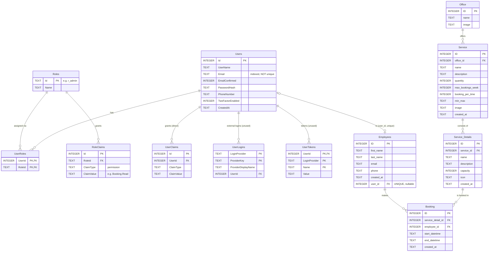

# Database — booking-app

This document describes the backend's database: what each table stores, how the tables depend on each other, and **why** each relationship exists. It also points out where the schema, the EF Core model and the original design disagree.

| | |
|---|---|
| **Engine** | SQLite (single file) |
| **File** | `backend/src/booking.api/app.db` (git-ignored) |
| **Schema source** | [`src/booking.infrastructure/Persistence/Sql/schema.sql`](src/booking.infrastructure/Persistence/Sql/schema.sql) |
| **ORM mapping** | [`src/booking.infrastructure/Persistence/AppDbContext.cs`](src/booking.infrastructure/Persistence/AppDbContext.cs) |
| **Created / seeded by** | [`DatabaseBootstrapper.cs`](src/booking.infrastructure/Persistence/DatabaseBootstrapper.cs) on app start |
| **Related docs** | [`DOC_BACKEND.md`](DOC_BACKEND.md) (how the code works), [`PROPOSAL.md`](PROPOSAL.md) (what to fix; finding IDs like `D7` refer to it) |

> Facts marked **(verified)** were checked against the live `app.db` or by the test suite in `test/booking.infrastructure.test`. Meanings marked **(inferred)** come from names and seed values, because the code doesn't enforce or document them.

---

## 1. The big picture

The 12 tables fall into two groups, joined by a single bridge column:

```
┌─────────────── Identity & access ───────────────┐        ┌──────────────── Booking domain ────────────────┐
│                                                 │        │                                                │
│  Roles ──< RoleClaims          UserLogins       │        │   Office ──< Service ──< Service_Details        │
│    │                              │             │        │                              │                 │
│    └──< UserRoles >── Users ──────┤             │        │                              ▼                 │
│                         │  └──< UserClaims      │        │                           Booking               │
│                         │         UserTokens ───┘        │                              ▲                 │
│                         └─────────── user_id ───────────────────────►  Employees ─────┘                  │
└─────────────────────────────────────────────────┘        └────────────────────────────────────────────────┘
```

- **Identity & access** answers *who can log in, and what are they allowed to do?* It follows the ASP.NET Core Identity table layout, but only `PasswordHasher<T>` from Identity is used. The queries are hand-written in `AuthService`.
- **Booking domain** answers *what can be booked, where, and who booked it when?* Office → Service → Service_Details is a catalog hierarchy, and **Booking** is the transaction table that connects a bookable item to an employee for a time range.
- **The bridge** is `Employees.user_id → Users.Id`. A login account (`Users`) is not the same thing as a person who books (`Employees`). Only users who have an employee row can own bookings. When they log in, the employee ID is put into the JWT as the `employee_id` claim.

### Entity-relationship diagram



---

## 2. General conventions (apply to every table)

| Topic | How it works here |
|---|---|
| **Primary keys** | `INTEGER PRIMARY KEY` is an alias for SQLite's `rowid`, so ids are auto-generated as `max(rowid)+1` when not supplied. There is no `AUTOINCREMENT` on business tables, so **ids of deleted rows at the end of a table can be reused**. The tests ran into this (see `ServicesServiceTests`). `Roles.Id` is the exception: a hand-chosen `TEXT` such as `r_admin`. |
| **Foreign keys** | SQLite only enforces FKs when `PRAGMA foreign_keys=ON`. EF Core's SQLite provider turns it on for every connection, so **FKs are enforced inside the app (verified)**. The `sqlite3` CLI does not turn it on by default. |
| **Delete behaviour** | Identity tables use `ON DELETE CASCADE`. **Business tables have no `ON DELETE` clause**, which means `NO ACTION`: deleting a parent that still has children fails with `FOREIGN KEY constraint failed`. That error surfaces as an HTTP 500 (verified; `PROPOSAL.md` D7, D8). |
| **Dates** | SQLite has no date type. Dates are stored as `TEXT` in EF's format `yyyy-MM-dd HH:mm:ss`, **with no time zone**. String comparison works only because the format is fixed-width. |
| **`DEFAULT (datetime('now'))`** | **Never takes effect through the app (verified).** EF always sends a value for mapped columns, so when the C# property is `null`, EF inserts `NULL` explicitly. `Users.CreatedAt`, `Service.created_at` and `Service_Details.created_at` are empty in the live DB. |
| **Booleans** | Stored as `INTEGER` 0/1 (`EmailConfirmed`, `TwoFactorEnabled`). |
| **Naming** | Mixed. Identity tables use `PascalCase` (`Users.Email`). Business tables use `snake_case` columns and singular names (`Service.office_id`, `Booking`), except `Employees`, which is plural. `AppDbContext` maps every column by hand with `HasColumnName`. |
| **Schema evolution** | No migrations. `schema.sql` runs **only if the `Users` table doesn't exist**. Any later change to `schema.sql` never reaches an existing database (`PROPOSAL.md` P2). |

---

## 3. Identity & access tables

### 3.1 `Users`: login accounts
**Purpose:** one row per account that can authenticate. It holds credentials, not personal or HR data.

| Column | Type | Null | Notes |
|---|---|---|---|
| `Id` | INTEGER PK | no | Generated. Becomes the JWT `sub` / `NameIdentifier` claim. |
| `UserName` | TEXT | yes | Defaults to the email on registration. JWT `Name` claim. |
| `Email` | TEXT | yes | Login identifier. Indexed by `IX_Users_Email`, but **not unique** (see §7). |
| `EmailConfirmed` | INTEGER | no (0) | Always set to `1`. There is no confirmation flow. |
| `PasswordHash` | TEXT | yes | ASP.NET Identity PBKDF2 hash (`PasswordHasher<User>`). Never plain text (verified by test). |
| `PhoneNumber`, `TwoFactorEnabled` | TEXT / INTEGER | | Identity-layout columns. Unused. |
| `CreatedAt` | TEXT | yes | Always `NULL` in practice (see §2). |

**Depends on:** nothing (root table).
**Depended on by:** `UserRoles`, `UserClaims`, `UserLogins`, `UserTokens` (all cascade on delete), and `Employees.user_id` (no cascade).
**Used by:** `AuthService.LoginAsync` (lookup by `lower(Email)`) and `RegisterAsync` (insert).

### 3.2 `Roles`: named groups of permissions
**Purpose:** a role bundles permissions so they don't have to be granted user by user.

| Column | Type | Notes |
|---|---|---|
| `Id` | TEXT PK | Fixed codes: `r_admin` (seeded), `r_user` (created on the first registration). |
| `Name` | TEXT | `Admin`, `User`. Goes into the JWT as `role` claims. |

**Depended on by:** `UserRoles`, `RoleClaims` (both cascade on delete, so deleting a role removes its assignments and permissions).

### 3.3 `UserRoles`: which user has which role (many-to-many)
**Purpose:** a junction table. A user can have many roles and a role can belong to many users.

| Column | Type | Notes |
|---|---|---|
| `UserId` | INTEGER PK, FK → `Users.Id` | `ON DELETE CASCADE` |
| `RoleId` | TEXT PK, FK → `Roles.Id` | `ON DELETE CASCADE` |

**Why it exists:** without it, a role would have to be a column on `Users`, which allows only one role per user. The composite PK `(UserId, RoleId)` prevents assigning the same role twice.
**Note:** `RegisterAsync` used to insert this row with `UserId = 0` (before the id was generated), which failed the FK. This is fixed in the working tree and covered by `Register_links_user_role_to_the_generated_user_id`.

### 3.4 `RoleClaims`: permissions granted to a role
**Purpose:** the actual authorization data. Each row says "role X has permission Y".

| Column | Type | Notes |
|---|---|---|
| `Id` | INTEGER PK AUTOINCREMENT | |
| `RoleId` | TEXT FK → `Roles.Id` | `ON DELETE CASCADE` |
| `ClaimType` | TEXT | Always `permission` (`Permissions.ClaimType`). |
| `ClaimValue` | TEXT | One of the 12 `Permissions.*` constants, e.g. `Booking.Read`. |

**Flow:** at login, `AuthService` gathers the `RoleClaims` of the user's roles plus the user's `UserClaims`, de-duplicates them, and writes each one as a `permission` claim into the JWT. The policies in `Program.cs` (`Booking.Read`, …) check those claims.
**Current data (verified):** only `r_admin → Booking.Read, Booking.Create`. `r_user` has **no** rows, so registered users have no permissions (`PROPOSAL.md` D5, D6). There is no unique constraint on `(RoleId, ClaimType, ClaimValue)`; duplicates are prevented only by checks in the seed code.

### 3.5 `UserClaims`: permissions granted directly to one user
**Purpose:** an exception mechanism that gives a single user an extra permission without creating a role. It has the same shape as `RoleClaims` but with an FK to `Users` (cascade).
**Current data:** empty. It is read at login but nothing writes to it.

### 3.6 `UserLogins` and `UserTokens`: unused
**Purpose (in ASP.NET Identity):** `UserLogins` links an account to an external provider (Google, Microsoft…). `UserTokens` stores per-user tokens (refresh, 2FA, reset).
**Here:** created by `schema.sql`, but they have **no EF entity, no code, and no rows**. They are leftovers from copying the Identity layout. Either delete them or use `UserTokens` for refresh tokens if those are added (`PROPOSAL.md` §6 Q5).

---

## 4. Booking domain tables

### 4.1 `Employees`: the people who book
**Purpose:** the HR/person record, meaning name, contact and so on. **Bookings belong to employees, not to users.**

| Column | Type | Null | Notes |
|---|---|---|---|
| `ID` | INTEGER PK | no | Seeded as 101–104. Exposed in the JWT as `employee_id`. |
| `first_name`, `last_name` | TEXT | **no** | The model has them as `string?`, so the nullability doesn't match. |
| `email`, `phone` | TEXT | yes | `email` duplicates `Users.Email`, and nothing keeps the two in sync. |
| `created_at` | TEXT | yes | Filled by the seed (and shifted to local time, see §6). |
| `user_id` | INTEGER FK → `Users.Id` | **yes** | `UNIQUE` index `UQ_Employees_User`. |

**Why it's separate from `Users`:**
- A person can exist without an account, e.g. imported from HR (`user_id NULL`).
- An account can exist without being an employee, e.g. a service account or a self-registered user.

The `UNIQUE` index on `user_id` makes this **one-to-zero-or-one**: an account maps to at most one employee.

**Gaps:**
- Registration does not create an employee, so new users can't own bookings (`PROPOSAL.md` D5).
- The model declares `UserId` as non-nullable `int`, but the column is nullable. Loading an employee with `user_id NULL` would throw.
- There's no FK delete rule, so deleting a user who has an employee row fails.

### 4.2 `Office`: physical or organizational location
**Purpose:** top of the catalog. It groups services by place, e.g. "Main Office" and "Remote Office".

| Column | Type | Null | Notes |
|---|---|---|---|
| `ID` | INTEGER PK | no | **The client can supply it on create** (`OfficeUpsertDto.id`); a duplicate gives a 500 (`PROPOSAL.md` D9). |
| `name` | TEXT | no | |
| `image` | TEXT | **no** | The DTO allows `null`, so creating an office without an image gives a 500 (verified, `PROPOSAL.md` D11). |

**Depended on by:** `Service.office_id`. **Why:** a service such as "Room Booking" is only meaningful at a specific location, so every service must belong to exactly one office.
**Missing:** a time zone and working hours. Availability hard-codes `08:00–15:00`, but those hours belong on the office (`PROPOSAL.md` D4, D10).

### 4.3 `Service`: a *type* of bookable thing at an office
**Purpose:** a category with booking rules, e.g. "Room Booking" or "Equipment Rental". It is never booked directly. Its children (`Service_Details`) are.

| Column | Type | Meaning | Enforced? |
|---|---|---|---|
| `ID` | INTEGER PK | | |
| `office_id` | INTEGER FK → `Office.ID`, NOT NULL | Where it's offered | FK only |
| `name`, `description`, `image` | TEXT | Display | |
| `quantity` | INTEGER | **(inferred)** how many units of this service exist (seed: 10 rooms, 20 equipment items) | **no** |
| `max_bookings_week` | INTEGER | **(inferred)** max bookings one employee can make per week | **no** |
| `booking_per_time` | INTEGER | **(inferred)** how many bookings may run at the same time, or how many one employee may hold at once | **no** |
| `min_max` | TEXT | **(inferred)** allowed duration in minutes, as a string `"min-max"` (seed: `"15-45"`, `"30-120"`) | **no** |
| `created_at` | TEXT | Set by `ServicesService` on create; `NULL` for seeded rows | |

**Why the rules live here:** they are shared by every item of the same kind. All rooms follow the same duration and weekly limits, so they're stored once on the parent instead of on each room.
**Gaps:**
- None of the rule columns are enforced anywhere (`PROPOSAL.md` D3).
- `min_max` should be two integer columns, so the database can validate them and queries can use them.
- The model has `OfficeId` but **no navigation property** to `Office`, and `Office` has no `Services` collection, so EF can't `Include` across them.

### 4.4 `Service_Details`: the concrete bookable item
**Purpose:** the actual thing someone books, e.g. "Small Room", "Large Room", "Projector" or "Laptop". Each belongs to exactly one service.

| Column | Type | Null | Notes |
|---|---|---|---|
| `ID` | INTEGER PK | no | **Referenced by bookings, so it must be stable.** |
| `service_id` | INTEGER FK → `Service.ID` | no | |
| `name` | TEXT | no | |
| `description`, `icon` | TEXT | yes | |
| `capacity` | INTEGER | yes | **(inferred)** people the item holds (Small Room = 4). Not used by availability. |
| `created_at` | TEXT | yes | |

**Why it's separate from `Service`:** availability and conflicts are per *physical item*. Two people can book "Room Booking" at 10:00 if they get different rooms, but not the same room.
**Gaps:**
- `ServicesService.UpdateAsync` **deletes and re-inserts every detail** on each edit. That changes their ids, and it fails with an FK error once any detail has a booking (verified, `PROPOSAL.md` D7).
- No `ON DELETE` rule, so deleting a service with details fails (verified, `PROPOSAL.md` D8).

### 4.5 `Booking`: who reserved which item, when
**Purpose:** the core transaction. One row means one employee holds one service detail from `start_datetime` to `end_datetime`.

| Column | Type | Null | Notes |
|---|---|---|---|
| `ID` | INTEGER PK | no | The client can supply it (`BookingUpsertDto.id`). |
| `service_detail_id` | INTEGER FK → `Service_Details.ID` | no | *What* is booked |
| `employee_id` | INTEGER FK → `Employees.ID` | no | *Who* booked. Currently taken from the request body, not the token (`PROPOSAL.md` S3). |
| `start_datetime`, `end_datetime` | TEXT | no | Time range, no time zone. Treated as half-open `[start, end)` by availability. |
| `created_at` | TEXT | yes | Supplied by the client, which should not be trusted. |

**Why it depends on `Service_Details` and not `Service`:** conflicts only make sense per physical item. **Why on `Employees` and not `Users`:** a booking belongs to a person, even if that person's login changes or is removed.
**Read paths:**
- `GetAvailability`: bookings `WHERE service_detail_id = ? AND start_datetime` falls on the given day.
- `GetByServiceIdAsync`: `Booking ⋈ Service_Details ⋈ Employees` filtered by `Service_Details.service_id`.

**Gaps:**
- No index on `service_detail_id` or `employee_id`, so both queries scan the whole table.
- No `CHECK (end_datetime > start_datetime)`.
- No overlap protection, so the same room can be double-booked (`PROPOSAL.md` D1).
- No status column, so cancelling means a hard delete.

---

## 5. Relationship reference

| Parent (1) | Child (N) | FK column | Cardinality | On delete | Why the dependency exists |
|---|---|---|---|---|---|
| `Users` | `UserRoles` | `UserId` | 1 : N | CASCADE | Role assignments mean nothing without the user |
| `Roles` | `UserRoles` | `RoleId` | 1 : N | CASCADE | Same, from the role side; together they form an M:N |
| `Roles` | `RoleClaims` | `RoleId` | 1 : N | CASCADE | Permissions are granted through roles |
| `Users` | `UserClaims` | `UserId` | 1 : N | CASCADE | Per-user permission overrides |
| `Users` | `UserLogins` / `UserTokens` | `UserId` | 1 : N | CASCADE | Identity leftovers, unused |
| `Users` | `Employees` | `user_id` (UNIQUE, nullable) | 1 : 0..1 | NO ACTION | Connects an authenticated account to the person who owns bookings |
| `Office` | `Service` | `office_id` | 1 : N | NO ACTION | A service is offered at one location |
| `Service` | `Service_Details` | `service_id` | 1 : N | NO ACTION | Concrete items share their category's rules |
| `Service_Details` | `Booking` | `service_detail_id` | 1 : N | NO ACTION | Conflicts and availability are per physical item |
| `Employees` | `Booking` | `employee_id` | 1 : N | NO ACTION | Ownership, weekly quotas and history are per person |

**Dependency order** (parents first). This is the order to create, seed or import data in; delete in the reverse order:

```
1. Users, Roles, Office
2. UserRoles, RoleClaims, UserClaims, Employees, Service
3. Service_Details
4. Booking
```

---

## 6. How the data flows through the tables

**Login** (`POST /api/auth/login`)
```
Users (by lower(Email)) → verify PasswordHash
  → UserRoles → Roles.Name                     ⇒ JWT "role" claims
  → RoleClaims (of those roles) ∪ UserClaims   ⇒ JWT "permission" claims
  → Employees (by user_id)                     ⇒ JWT "employee_id" claim
```

**Browse the catalog** (`GET /api/services`)
```
Service + Service_Details (Include)   — Office is not joined; every service is returned with its officeId
```

**Check availability** (`POST /api/booking/availability` with a detail id, date and frequency)
```
Booking WHERE service_detail_id = id AND start_datetime ∈ [date, date+1)
  → generate slots 08:00..15:00 every <frequency> minutes
  → a slot is taken if a booking covers its start time
```
(The overlap logic is wrong for bookings that start mid-slot; see `PROPOSAL.md` D2.)

**Create a booking** (`POST /api/booking`)
```
INSERT Booking(service_detail_id, employee_id, start, end)
  → the only checks are the two FKs (detail and employee must exist); no business rules run
```

---

## 7. Integrity problems found in the schema

| # | Problem | Evidence | Fix |
|---|---|---|---|
| 1 | `Users.Email` is indexed but **not unique**, so two concurrent registrations can create duplicate accounts | `schema.sql:12` | `UNIQUE` on a `NormalizedEmail` column, and look users up by it (this also makes the index usable instead of `lower(Email)`) |
| 2 | Business FKs have no delete rule, so deleting a parent with children gives a 500 | verified by tests (D7, D8) | Decide per relationship: `RESTRICT` plus soft delete (`is_active`) for the catalog; never hard-delete bookings |
| 3 | `DEFAULT (datetime('now'))` never applies | `Users.CreatedAt`, `Service.created_at` empty in `app.db` | Set timestamps in a `SaveChanges` interceptor, or configure `ValueGeneratedOnAdd` |
| 4 | Times are stored without a zone, and the seed converts UTC to the server's local time | Seed `2024-10-18T10:00:00Z` is stored as `2024-10-18 05:00:00` in `app.db` (UTC−5 machine) | Store UTC only (`DateTimeOffset` at the edges); give `Office` a time zone |
| 5 | No index for the main booking queries | `sqlite_master` lists no Booking indexes | `(service_detail_id, start_datetime)`, `(employee_id, start_datetime)` |
| 6 | No `CHECK (end_datetime > start_datetime)` | `schema.sql:105-114` | Add the constraint |
| 7 | Nullability differs between SQL, model and DTO | `Office.image`, `Employees.user_id`, `Employees.first_name` | Make the three layers agree |
| 8 | Service-detail ids aren't stable (delete and re-insert on update; rowid reuse) | D7 | Update details in place by id; add `AUTOINCREMENT` if ids must never be reused |
| 9 | Business rules stored as free text (`min_max = "15-45"`) | `Service.min_max` | `min_duration_min` / `max_duration_min` INTEGER columns with `CHECK` |
| 10 | Unused tables `UserLogins`, `UserTokens` | 0 rows, no entity | Drop them, or adopt them deliberately |
| 11 | No unique constraint on `RoleClaims(RoleId, ClaimType, ClaimValue)` | `schema.sql:35` | Add a unique index |
| 12 | Demo booking isn't seeded on a fresh DB | verified by test (D13) | Save employees and details before looking them up, or use the known ids directly |

---

## 8. Original design vs. what was built

`data-structure.png` and `booking-app-seed-data.json` at the repo root show the starting design, which had four tables. The implementation changed several things:

| Design (`data-structure.png`) | Implementation (`schema.sql`) | Effect |
|---|---|---|
| `services`, `service_detail`, `Employees`, `bookings` | Same four plus **`Office`** and seven identity tables | Adds locations and login/permissions |
| `services.capacity` (seed: parking = 14, desks = 40, which looks like *number of units*) | `Service.quantity` plus `Service_Details.capacity` (people per item) | "Capacity" now means something different. Clarify before enforcing it (`PROPOSAL.md` §6 Q2) |
| `services.max_bookings_week` | Kept as `max_bookings_week`, plus new `booking_per_time` and `min_max` | More rules, none enforced |
| `Employees.email` **unique** | Not unique | Weaker than the design |
| No link between employees and logins | `Employees.user_id → Users.Id` (unique) | Lets the JWT carry `employee_id` |
| Employee ids 101–103 = Sarah, Michael, Emma | 101 = Admin, 102 = Sarah, 103 = Michael, 104 = Emma | Seed JSON and DB ids don't line up; don't import the JSON as-is |

---

## 9. Seed data (what a fresh database contains)

Created by `DatabaseBootstrapper.SeedAsync` on every start, idempotently:

| Table | Rows |
|---|---|
| `Users` | 1 `admin@demo.com`, 2 `sarah.johnson@…`, 3 `michael.chen@…`, 4 `emma.rodriguez@…`, all with password `P@ssw0rd!` |
| `Roles` / `UserRoles` | `r_admin` assigned to user 1 |
| `RoleClaims` | `r_admin`: `Booking.Read`, `Booking.Create` |
| `Employees` | 101 → user 1, 102 → user 2, 103 → user 3, 104 → user 4 |
| `Office` | 1 Main Office, 2 Remote Office |
| `Service` | 1 Room Booking (office 1), 2 Equipment Rental (office 1) |
| `Service_Details` | 1 Small Room, 2 Large Room (service 1); 3 Projector, 4 Laptop (service 2) |
| `Booking` | One for Sarah in Small Room, **only from the second start onwards** (D13) |

> The seed runs in every environment, including production, which means well-known credentials (`PROPOSAL.md` S7).

---

## 10. Inspecting the database

```bash
# from backend/src/booking.api — read-only, so you don't lock the running app
sqlite3 -readonly app.db ".tables"
sqlite3 -readonly app.db ".schema Booking"
sqlite3 -readonly app.db "PRAGMA foreign_key_list(Booking);"
sqlite3 -readonly app.db "SELECT * FROM Booking;"
```

To rebuild from scratch: stop the API, delete `app.db`, and start it again. `schema.sql` and the seed run automatically. Start it a second time if you need the demo booking (D13).
